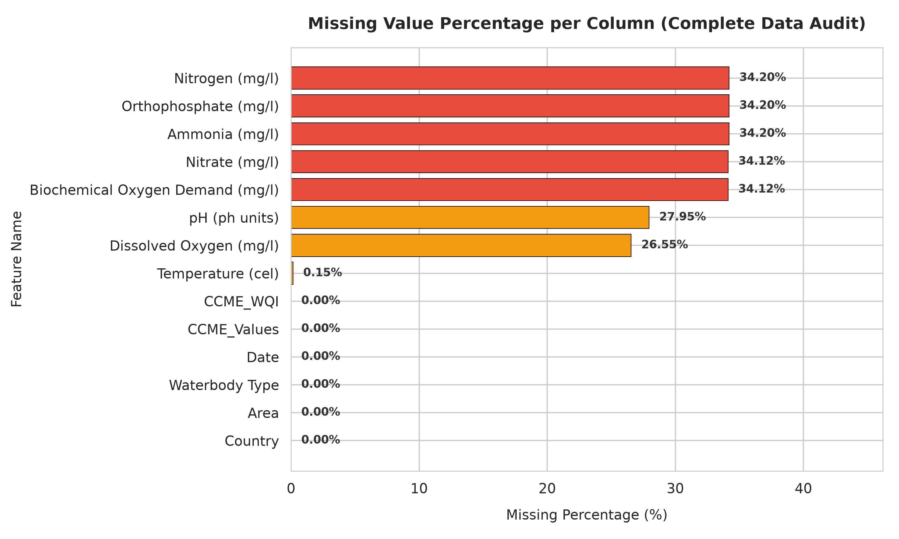
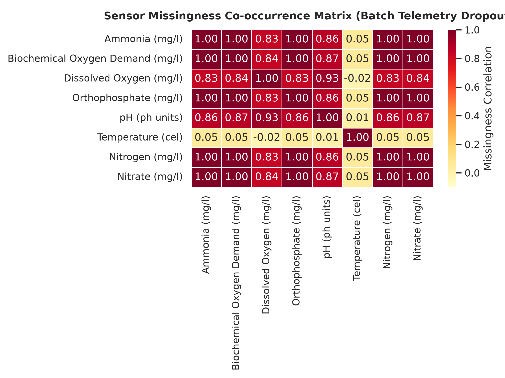
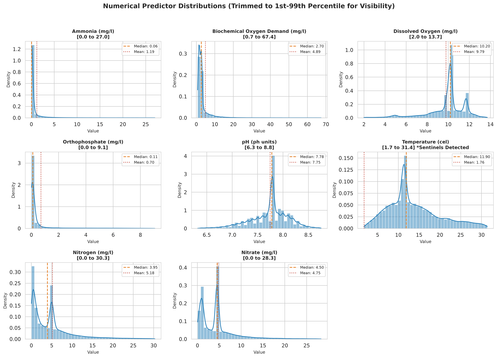
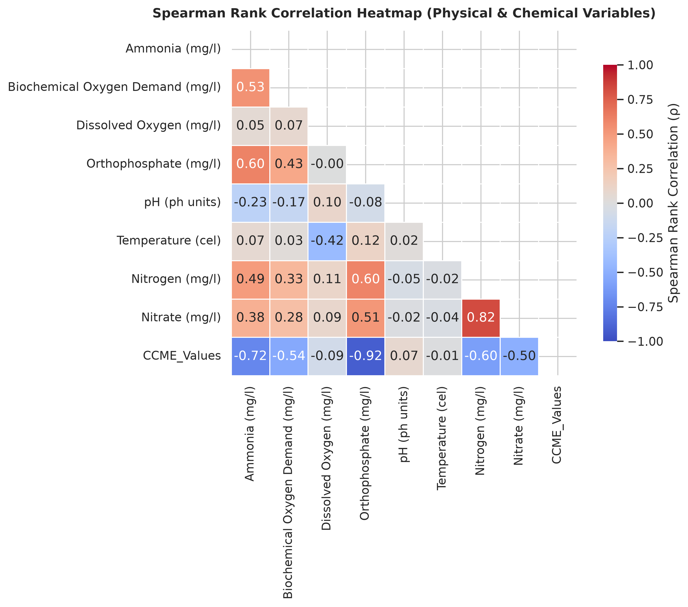
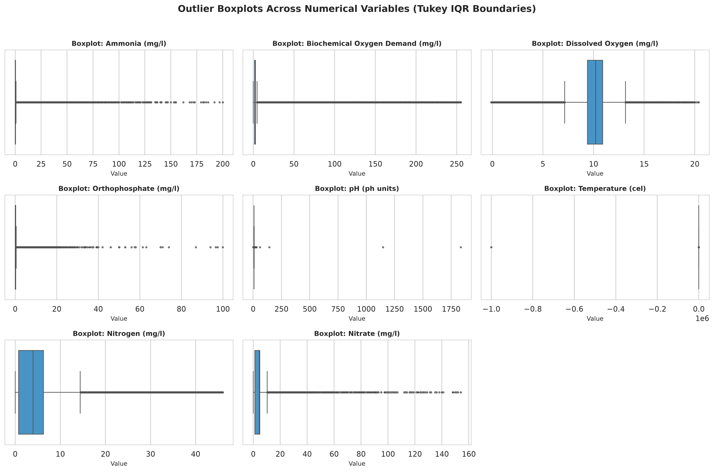
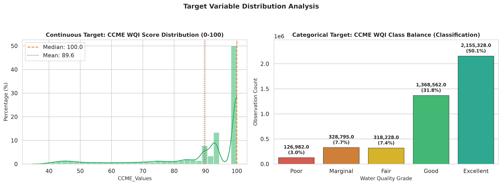

# Water Quality Prediction ML Project — Dataset Inspection & Quality Audit Report

> **Generated Automatically by**: `src/data_audit.py`  
> **Audit Date**: 2026-10-21 14:53:51  
> **Audited File**: `../data/Dataset/Parquet/Combined Data/Combined_dataset.csv`  
> **Dataset Shape**: 4,297,895 rows × 14 columns  
> **In-Memory Size**: 660.9 MB  

---

## 1. Executive Summary & Audit Highlights

This data quality audit evaluates the faculty-provided surface water quality dataset prior to downstream
data preprocessing, feature engineering, and model training (Gradient Boosting & Deep Neural Networks).

### Key Audit Findings:
1. **Scale & Completeness**: The dataset contains **4,297,895 rows** and **14 columns**.
   - **2,827,977 complete rows** (65.799%) have zero missing values across all columns.
   - Overall missing cell rate is **16.106%**.
2. **Duplication**: Detected **10,005 exact duplicate rows** (0.2328%), which should be deduplicated prior to modeling to avoid train-test data leakage.
3. **Telemetry Hardware Sentinels**: Detected extreme error codes recorded as **`-999999.0`**:
   - `Temperature (cel)`: **80 occurrences** of `-999999.0` (causing raw mean to distort to negative values).
   - `pH (ph units)`: **3 occurrences** of `-999999.0`, plus **1 occurrence** of `-1.0`.
   - `Dissolved Oxygen (mg/l)`: **1 occurrence** of `-999999.0`.
4. **Sensor Scale Corruptions**: A severe multiplier anomaly was discovered in `pH (ph units)` with a maximum value of **`67115.0`** (natural freshwater is bounded between 3.0 and 11.0).
5. **Detection Limit Offsets**: Small negative concentrations (e.g. Ammonia `-0.005 mg/L`, BOD `-2.0 mg/L`, DO `-0.1 mg/L`) reflect baseline sensor calibration offsets below instrument detection thresholds.
6. **Missingness Synchrony**: Nutrients (`Ammonia`, `Orthophosphate`, `Nitrogen`, `Nitrate`) share an identical missing rate (**34.20%**, 1,469,831 rows) representing synchronized laboratory grab-sample panels vs continuous probe telemetry.
7. **Target Variables**: Continuous target `CCME_Values` spans **31.30 to 100.0** (mean 89.61). Categorical target `CCME_WQI` exhibits significant class imbalance (**50.1% Excellent vs 3.0% Poor**), requiring class-weighted loss or stratified splits.

---

## 2. Dataset Structure, Schema & Dtypes

| Index | Column Name | Inferred Dtype | Non-Null Count | Missing Count | Missing % | Unique Count | Sample Value |
|---|---|---|---|---|---|---|---|
| 0 | `Country` | `str` | 4,297,895 | 0 | 0.0% | 7 | `Australia` |
| 1 | `Area` | `str` | 4,297,895 | 0 | 0.0% | 64,665 | `Torrens River Adelaide Zoo Pedestrian Bridge` |
| 2 | `Waterbody Type` | `str` | 4,297,895 | 0 | 0.0% | 13 | `River` |
| 3 | `Date` | `str` | 4,297,895 | 0 | 0.0% | 24,013 | `01-12-2014` |
| 4 | `Ammonia (mg/l)` | `float64` | 2,828,064 | 1,469,831 | 34.199% | 13,987 | `0.083` |
| 5 | `Biochemical Oxygen Demand (mg/l)` | `float64` | 2,831,561 | 1,466,334 | 34.117% | 4,846 | `1.3` |
| 6 | `Dissolved Oxygen (mg/l)` | `float64` | 3,156,915 | 1,140,980 | 26.547% | 17,731 | `4.15` |
| 7 | `Orthophosphate (mg/l)` | `float64` | 2,828,064 | 1,469,831 | 34.199% | 10,596 | `0.062` |
| 8 | `pH (ph units)` | `float64` | 3,096,820 | 1,201,075 | 27.946% | 5,218 | `7.4` |
| 9 | `Temperature (cel)` | `float64` | 4,291,337 | 6,558 | 0.153% | 17,265 | `24.7` |
| 10 | `Nitrogen (mg/l)` | `float64` | 2,828,064 | 1,469,831 | 34.199% | 16,232 | `0.81` |
| 11 | `Nitrate (mg/l)` | `float64` | 2,831,464 | 1,466,431 | 34.12% | 11,055 | `0.769` |
| 12 | `CCME_Values` | `float64` | 4,297,895 | 0 | 0.0% | 224,831 | `93.10212742440228` |
| 13 | `CCME_WQI` | `str` | 4,297,895 | 0 | 0.0% | 5 | `Good` |

---

## 3. Missing Value Analysis

- **Total Data Cells**: 60,170,530
- **Total Missing Cells**: 9,690,871 (16.106%)
- **Complete Rows (0 missing)**: 2,827,977 (65.799%)

| Column | Missing Count | Missing % | Severity Classification |
|---|---|---|---|
| `Ammonia (mg/l)` | 1,469,831 | 34.199% | Moderate (1-35%) |
| `Orthophosphate (mg/l)` | 1,469,831 | 34.199% | Moderate (1-35%) |
| `Nitrogen (mg/l)` | 1,469,831 | 34.199% | Moderate (1-35%) |
| `Nitrate (mg/l)` | 1,466,431 | 34.12% | Moderate (1-35%) |
| `Biochemical Oxygen Demand (mg/l)` | 1,466,334 | 34.117% | Moderate (1-35%) |
| `pH (ph units)` | 1,201,075 | 27.946% | Moderate (1-35%) |
| `Dissolved Oxygen (mg/l)` | 1,140,980 | 26.547% | Moderate (1-35%) |
| `Temperature (cel)` | 6,558 | 0.153% | Low (<1%) |
| `Country` | 0 | 0.0% | Complete (0%) |
| `Area` | 0 | 0.0% | Complete (0%) |
| `Waterbody Type` | 0 | 0.0% | Complete (0%) |
| `Date` | 0 | 0.0% | Complete (0%) |
| `CCME_Values` | 0 | 0.0% | Complete (0%) |
| `CCME_WQI` | 0 | 0.0% | Complete (0%) |

---

## 4. Duplicate Rows & Cardinality Audit

- **Exact Duplicate Rows**: 10,005 (0.2328%)
- **Evaluated Columns**: All Columns

### Unique Value Cardinality Breakdown

| Column | Unique Count | Uniqueness Ratio | Cardinality Tier | Most Frequent Value | Mode Frequency | Mode % |
|---|---|---|---|---|---|---|
| `Country` | 7 | 0.0 | Low Cardinality (Categorical) | `England` | 2,129,198 | 49.54% |
| `Area` | 64,665 | 0.01505 | Medium Cardinality | `Lake Washington` | 54,281 | 1.263% |
| `Waterbody Type` | 13 | 0.0 | Low Cardinality (Categorical) | `River` | 1,856,281 | 43.19% |
| `Date` | 24,013 | 0.00559 | Medium Cardinality | `12-03-2018` | 1,259 | 0.029% |
| `Ammonia (mg/l)` | 13,987 | 0.00325 | Medium Cardinality | `0.03` | 526,717 | 12.255% |
| `Biochemical Oxygen Demand (mg/l)` | 4,846 | 0.00113 | Medium Cardinality | `2.7` | 686,787 | 15.98% |
| `Dissolved Oxygen (mg/l)` | 17,731 | 0.00413 | Medium Cardinality | `10.2` | 895,481 | 20.835% |
| `Orthophosphate (mg/l)` | 10,596 | 0.00247 | Medium Cardinality | `0.144` | 444,309 | 10.338% |
| `pH (ph units)` | 5,218 | 0.00121 | Medium Cardinality | `7.78` | 367,499 | 8.551% |
| `Temperature (cel)` | 17,265 | 0.00402 | Medium Cardinality | `11.46` | 311,639 | 7.251% |
| `Nitrogen (mg/l)` | 16,232 | 0.00378 | Medium Cardinality | `5.0` | 409,140 | 9.52% |
| `Nitrate (mg/l)` | 11,055 | 0.00257 | Medium Cardinality | `4.5` | 716,631 | 16.674% |
| `CCME_Values` | 224,831 | 0.05231 | Medium Cardinality | `100.0` | 2,155,328 | 50.148% |
| `CCME_WQI` | 5 | 0.0 | Low Cardinality (Categorical) | `Excellent` | 2,155,328 | 50.148% |

---

## 5. Basic Numerical Statistics & Distribution Percentiles

| Column | Count | Mean | Std | Min | 1% | 25% (Q1) | Median | 75% (Q3) | 99% | Max | IQR | Skewness |
|---|---|---|---|---|---|---|---|---|---|---|---|---|
| `Ammonia (mg/l)` | 2,828,064 | 1.1713 | 5.6688 | -0.005 | 0.009 | 0.03 | 0.055 | 0.317 | 26.7 | 200.0 | 0.287 | 12.004 |
| `Biochemical Oxygen Demand (mg/l)` | 2,831,561 | 4.8875 | 16.4226 | -2.0 | 0.69 | 1.6 | 2.7 | 2.83 | 68.2 | 534.5 | 1.23 | 10.252 |
| `Dissolved Oxygen (mg/l)` | 3,156,915 | 9.4699 | 562.8277 | -999999.0 | 2.05 | 9.39 | 10.2 | 10.9 | 13.7 | 23.75 | 1.51 | -1776.7331 |
| `Orthophosphate (mg/l)` | 2,828,064 | 0.7105 | 2.0894 | -0.004 | 0.004 | 0.04 | 0.107 | 0.227 | 9.14 | 100.0 | 0.187 | 8.9534 |
| `pH (ph units)` | 3,096,820 | 6.8292 | 985.4009 | -999999.0 | 6.33 | 7.51 | 7.78 | 8.0 | 8.73 | 67115.0 | 0.49 | -1012.3303 |
| `Temperature (cel)` | 4,291,337 | -4.8807 | 4317.6833 | -999999.0 | 1.7 | 9.3 | 11.9 | 17.2 | 31.4 | 98.0 | 7.9 | -231.5995 |
| `Nitrogen (mg/l)` | 2,828,064 | 5.2094 | 6.2004 | 0.0 | 0.019 | 0.78 | 4.0 | 6.32 | 30.3 | 46.0 | 5.54 | 2.3939 |
| `Nitrate (mg/l)` | 2,831,464 | 4.7636 | 6.093 | 0.0 | 0.045 | 1.17 | 4.5 | 4.94 | 28.3 | 790.02 | 3.77 | 6.9556 |
| `CCME_Values` | 4,297,895 | 89.6147 | 15.7517 | 31.3041 | 41.7981 | 88.2691 | 100.0 | 100.0 | 100.0 | 100.0 | 11.7309 | -1.76 |

---

## 6. Categorical Feature Distributions

| Column | Non-Null Count | Missing | Unique Categories | Top Categories Distribution |
|---|---|---|---|---|
| `Country` | 4,297,895 | 0 | 7 | England: 2,129,198 (49.54%); USA: 1,879,966 (43.74%); Ireland: 235,019 (5.47%); China: 45,997 (1.07%); Canada: 3,995 (0.09%) |
| `Area` | 4,297,895 | 0 | 64,665 | Lake Washington: 54,281 (1.26%); Hou Bay: 45,997 (1.07%); Lake Sammamish: 26,818 (0.62%); Central Puget Sound: 22,499 (0.52%); Los Angeles: 21,478 (0.5%) |
| `Waterbody Type` | 4,297,895 | 0 | 13 | River: 1,856,281 (43.19%); Stream: 1,466,152 (34.11%); Effluent: 601,550 (14.0%); Lake: 153,667 (3.58%); Estuarine: 49,375 (1.15%) |
| `Date` | 4,297,895 | 0 | 24,013 | 12-03-2018: 1,259 (0.03%); 12-11-2019: 1,146 (0.03%); 11-02-2020: 1,107 (0.03%); 06-01-2015: 1,089 (0.03%); 12-02-2020: 1,086 (0.03%) |
| `CCME_WQI` | 4,297,895 | 0 | 5 | Excellent: 2,155,328 (50.15%); Good: 1,368,562 (31.84%); Marginal: 328,795 (7.65%); Fair: 318,228 (7.4%); Poor: 126,982 (2.95%) |

---

## 7. Suspicious Values, Sentinels & Outlier Diagnostic Audit

> [!WARNING]
> The following anomalies and hardware sentinels were identified during the audit.
> **Per project requirements, NO records have been deleted automatically.**
> These findings are documented here to guide downstream preprocessing.

| Column | Non-Null | Negatives | Negative % | Sentinels (≤-999) | Sentinel Details | Domain Violations | Mild Outliers (IQR 1.5) | Extreme Outliers (IQR 3.0) |
|---|---|---|---|---|---|---|---|---|
| `Ammonia (mg/l)` | 2,828,064 | 2 | 0.0001% | 0 | `None` | 2 | 404,724 (14.311%) | 325,018 (11.493%) |
| `Biochemical Oxygen Demand (mg/l)` | 2,831,561 | 2 | 0.0001% | 0 | `None` | 2 | 413,563 (14.605%) | 295,653 (10.441%) |
| `Dissolved Oxygen (mg/l)` | 3,156,915 | 95 | 0.003% | 1 | `{-999999.0: 1}` | 95 | 373,323 (11.826%) | 142,526 (4.515%) |
| `Orthophosphate (mg/l)` | 2,828,064 | 10 | 0.0004% | 0 | `None` | 10 | 470,130 (16.624%) | 392,689 (13.885%) |
| `pH (ph units)` | 3,096,820 | 4 | 0.0001% | 4 | `{-999999.0: 3, 67115.0: 1}` | 597 | 116,233 (3.753%) | 23,442 (0.757%) |
| `Temperature (cel)` | 4,291,337 | 1,877 | 0.0437% | 80 | `{-999999.0: 80}` | 6,067 | 131,805 (3.071%) | 7,496 (0.175%) |
| `Nitrogen (mg/l)` | 2,828,064 | 0 | 0.0% | 0 | `None` | 0 | 216,434 (7.653%) | 81,858 (2.894%) |
| `Nitrate (mg/l)` | 2,831,464 | 0 | 0.0% | 0 | `None` | 0 | 251,227 (8.873%) | 112,907 (3.988%) |
| `CCME_Values` | 4,297,895 | 0 | 0.0% | 0 | `None` | 0 | 546,719 (12.721%) | 299,822 (6.976%) |

---

## 8. Target Variable Distribution

### Target: `CCME_Values` (Continuous / Regression)
- **Range**: [31.304, 100.0]
- **Mean ± Std**: 89.615 ± 15.752
- **Median (IQR)**: 100.0 (Q1: 88.269, Q3: 100.0)
- **Skewness**: -1.76

### Target: `CCME_WQI` (Categorical / Classification)
- **Unique Classes**: 5
- **Majority Class**: Excellent (50.1%)
- **Minority Class**: Poor (3.0%)
- **Class Imbalance Ratio**: 16.97:1
- **Class Breakdown**:
| Class | Count | Percentage |
|---|---|---|
| `Excellent` | 2,155,328 | 50.15% |
| `Good` | 1,368,562 | 31.84% |
| `Marginal` | 328,795 | 7.65% |
| `Fair` | 318,228 | 7.4% |
| `Poor` | 126,982 | 2.95% |

---

## 9. Downstream Recommendations for Preprocessing & Modeling

1. **Sentinel Value Replacement**: Replace telemetry sentinels (`-999999.0` in Temperature, pH, and DO) and extreme multipliers (`pH = 67115.0`) with `NaN` before imputation, to avoid gradient explosion in neural networks and distorted scaling.
2. **Zero-Clipping for Physical Concentrations**: Negative values in chemical concentrations (Ammonia, BOD, DO, Orthophosphate) within $[-2.0, 0.0)$ are instrument baseline offsets and should be clipped to `0.0`.
3. **Deduplication**: Drop the **10,005 exact duplicate rows** prior to splitting train/val/test splits.
4. **Stratified Splitting**: When creating the 70/15/15 split, stratify across `Country`, `Waterbody Type`, and `CCME_WQI` to maintain identical class ratios across all partitions.
5. **Handling Nutrient Missingness**: Baseline tree models can be benchmarked on the 2.41M complete cases, while nationwide telemetry models can employ iterative or KNN imputation.
6. **Loss Function Adjustment**: Address the **17:1 class imbalance** in `CCME_WQI` using class weights or Focal Loss.

---
*Report generated and verified reproducibly.*