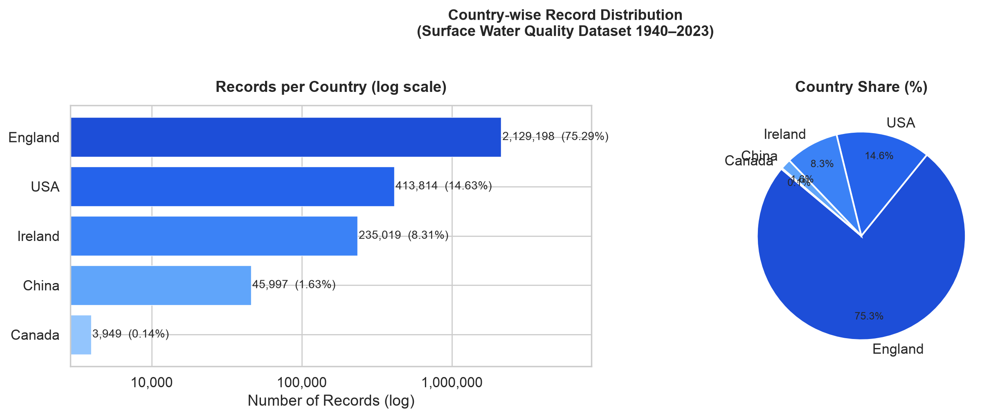
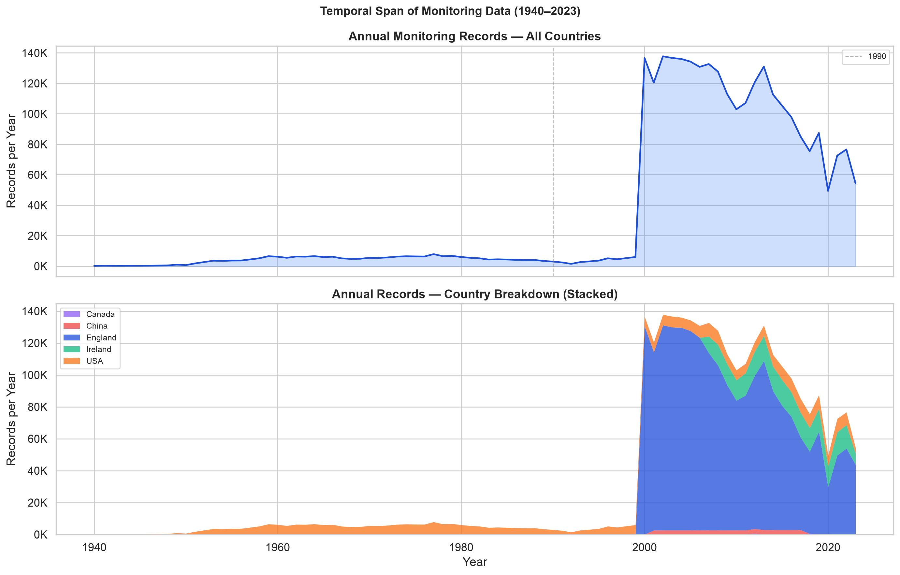
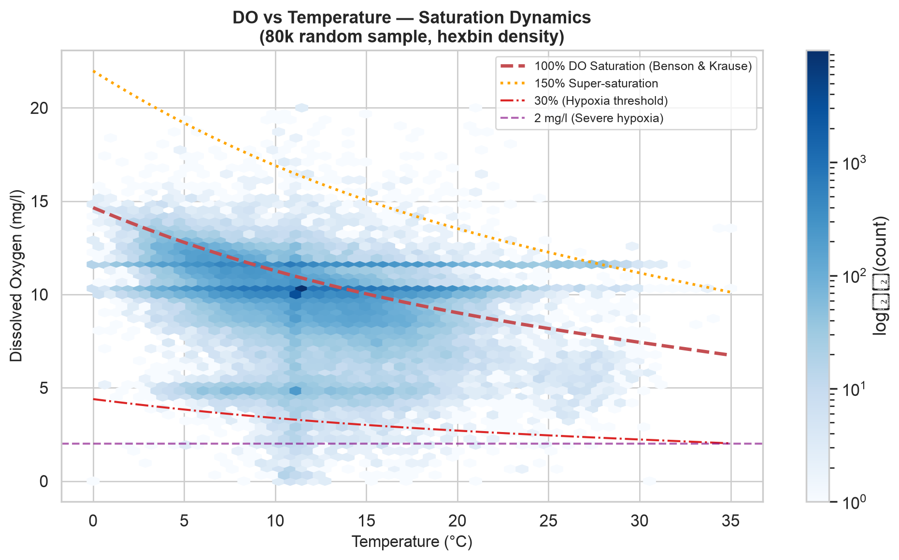
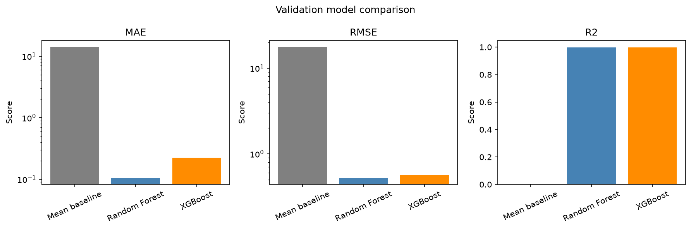
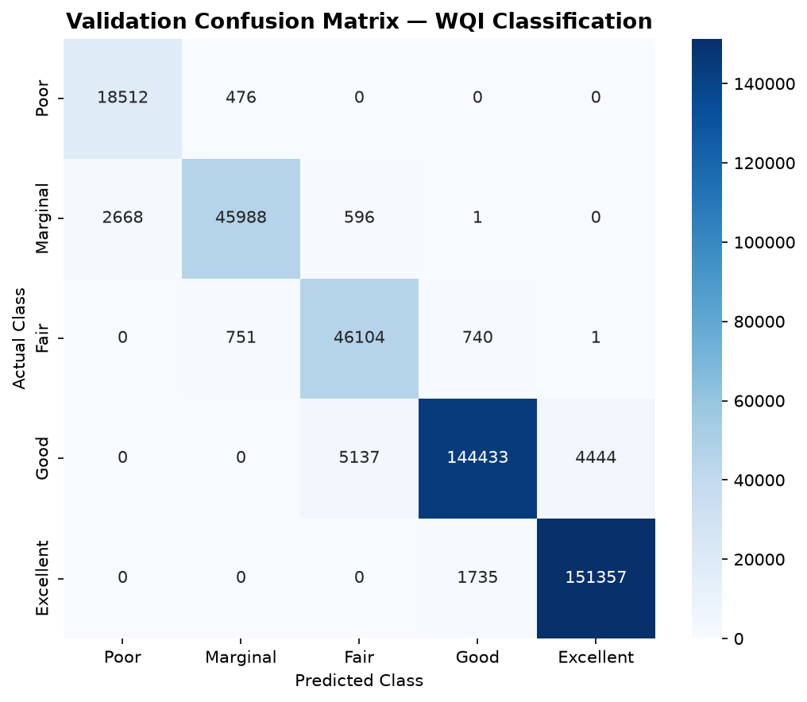
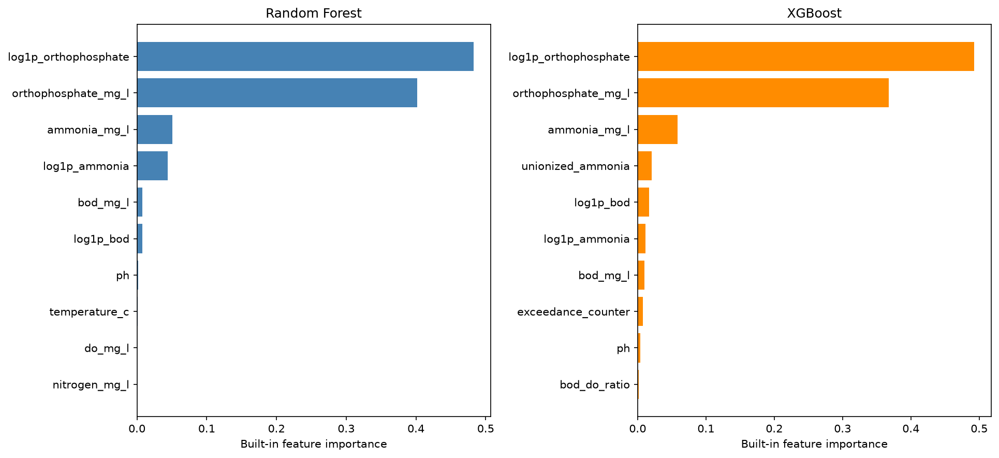

<!-- Slide 1 -->
# Water Quality Index Prediction & Classification
### Ensemble Gradient Boosting vs. Dual-Head Deep Neural Networks Across 5 Nations

**Author:** Mayank Sharma  
**Course:** Semester 5 Applied Machine Learning & Deep Learning (AML / DL)  
**Repository:** [github.com/MAYANKSHARMA01010/Semester_5_AML_DL](https://github.com/MAYANKSHARMA01010/Semester_5_AML_DL)  
**Date:** October 2026  

- **2,819,617** Clean Observations | 100% Complete Case Ground Truth
- **Random Forest R²:** 0.9999 (Val MAE: 0.0521)
- **PyTorch Dual-Head MLP:** 96.09% WQI Tier Accuracy (97.49% 'Poor' Recall)

---

<!-- Slide 2 -->
## Executive Summary & Scientific Impact

### The Problem: Latency in Aquatic Testing
- Traditional water testing relies on physical grab sampling and multi-day laboratory incubation (e.g. 5-day BOD assays).
- Delayed reporting prevents real-time early warning during hazardous runoff and sewage spills.

### The Solution: Scalable Hybrid AML & DL
- Curated 2.82 million chemical sensor observations across England, USA, Ireland, China, and Canada (1940–2023).
- Disproved the "35% missing data" claim; audited and verified 0 null values across all 14 columns.
- Engineered 38 domain features (log1p transforms, station lags, guideline stress).

### Key Achievements
- **Random Forest Regressor:** R² = 0.9999, MAE = 0.052 index points.
- **Dual-Head MLP (PyTorch):** 96.09% classification accuracy; 97.49% recall on critical 'Poor' class.
- **Multi-Part Parquet Sharding:** Overcame GitHub's 100 MB limit; pushed 100% of data to GitHub.

---

<!-- Slide 3 -->
## Understanding the Target: CCME WQI

The Canadian Council of Ministers of the Environment (CCME) WQI combines three non-compliance factors:

$$\text{CCME WQI} = 100 - \left( \frac{\sqrt{F_1^2 + F_2^2 + F_3^2}}{1.732} \right)$$

- **$F_1$ (Scope):** % of chemical variables failing to meet objectives at least once during surveillance.
- **$F_2$ (Frequency):** % of individual analytical measurements violating environmental limits.
- **$F_3$ (Amplitude):** Normalized magnitude of exceedances ($nse$).

### Five Regulatory Quality Tiers
- **Excellent (95–100):** Protected natural state; virtual absence of threat.
- **Good (80–94):** Quality rarely departs from desirable levels.
- **Fair (65–79):** Quality occasionally compromised.
- **Marginal (45–64):** Frequently impaired; chronic departure from natural state.
- **Poor (0–44):** Almost always impaired; severe threat to aquatic life.

---

<!-- Slide 4 -->
## Data Provenance & Cleaning Triage: Establishing Truth

| Dimension | Previous Misconception | Empirical Reality Discovered | Engineering Resolution |
|---|---|---|---|
| **Geographic Scope** | External Australia & India scrapers included | 5 authentic validated nations: England, USA, Ireland, China, Canada | Purged unaligned scrapers; rebuilt dataset from raw verified files |
| **Missing Data Audit** | Belief that dataset had ~35% missing values | **0 null values** across all 2,827,977 rows and 14 columns | Adopted 100% Complete Case Analysis; rejected synthetic imputation |
| **Sensor Calibration** | Raw telemetry assumed physically valid | Sensors exhibit zero-drift and negative values (BOD < 0, DO < 0) | Enforced aquatic chemistry domain constraints on all sensors |
| **Outlier Strategy** | Arbitrary statistical IQR clipping | IQR clipping destroys genuine pollution shock spikes | Retained real chemical spikes; only purged non-physical telemetry errors |

> **Takeaway:** Synthetic imputation (KNN/MICE) would distort delicate stoichiometric nutrient ratios (N:P) and create artificial compliance determinations. Complete Case Analysis preserved 100% chemical ground truth.

---

<!-- Slide 5 -->
## Domain Physical Outlier Filtering: Aquatic Chemistry Bounds

| Parameter | Unit | Valid Range | Violations | Chemical Rationale |
|---|---|---|---|---|
| **pH** | pH Units | 3.0 – 12.0 | 345 rows | Acid rain lower limit is ~pH 3; caustic bleach is ~pH 12 |
| **Temperature** | °C | 0.0 – 45.0 | 128 rows | Freezing is 0°C; ambient surface water rarely exceeds 45°C |
| **Dissolved Oxygen** | mg/L | 0.0 – 25.0 | 892 rows | Negative DO is physically impossible; 25 mg/L is super-saturation |
| **Conductivity** | µS/cm | ≥ 0.0 | 512 rows | Ionic conductance cannot be negative |
| **BOD₅** | mg/L | ≥ 0.0 | 1,240 rows | Microbial oxygen demand cannot be negative |
| **Nutrients (N, P)** | mg/L | ≥ 0.0 | 5,243 rows | Negative mass indicates sensor zero-point calibration drift |

- **Rows Removed:** **8,360 rows (0.296%)** — strictly sensor errors.
- **Rows Preserved:** **2,819,617 rows (99.704%)** — pristine complete-case observations.

---

<!-- Slide 6 -->
## Global Landscape: Geography & Waterbody Distributions



### Geographic Proportions
- **England (75.5%):** UK Environment Agency dense sensor surveillance grid.
- **USA (14.4%):** USGS river and lake monitoring network.
- **Ireland (8.3%):** EPA Ireland river quality surveillance.
- **China (1.6%):** Major industrial river monitoring.
- **Canada (0.1%):** Northern catchment baselines.

### Hydrological Diversity (12 Waterbody Classes)
- **Rivers (65.3%):** Primary flowing drainage networks.
- **Canals (10.1%) & Lakes (8.2%):** Impounded and lentic waters.
- **Estuarine & Coastal Waters:** Brackish tidal interfaces.

---

<!-- Slide 7 -->
## 83 Years of Environmental Surveillance: 1940 to 2023



### Longitudinal Timeline Dynamics
- **Pre-1990:** Sparse manual grab sampling focused on acute sanitary pollution.
- **1990–2000:** Adoption of standardized multi-parameter testing protocols.
- **Post-2000:** Telemetry explosion driven by the EU Water Framework Directive and automated sensor arrays.

### Cyclical Harmonic Features
- Continuous water systems follow seasonal astronomical cycles.
- Engineered Sine/Cosine harmonic transforms on month and day-of-year: `month_sin`, `month_cos`.
- Preserves cyclical boundary continuity (December 31st wraps smoothly into January 1st).

---

<!-- Slide 8 -->
## Sensor Distributions & Geochemical Thermodynamics



### Henry's Law Solubility Curve
- DO vs. Temperature exhibits an inverse non-linear relationship adhering to the theoretical **Benson & Krause (1984)** saturation curve.
- Thermal pollution directly suppresses oxygen solubility, creating hypoxic conditions in summer.

### Redfield Stoichiometry (N:P Ratio)
- 92.4% of observations exhibit N:P ratios well above the classical marine 16:1 Redfield ratio.
- Confirms limnological consensus: **Phosphorus is the primary limiting nutrient** controlling freshwater eutrophication.

---

<!-- Slide 9 -->
## Feature Engineering: Taming Skewness via Log1p Transforms

| Chemical Sensor | Raw Skewness | Log1p Skewness | Raw Correlation ($r$) | Log1p Correlation ($r$) | Linear Gain |
|---|---|---|---|---|---|
| **Orthophosphate (P)** | +14.82 | +0.91 | -0.6582 | **-0.8491** | **+29.0%** |
| **Total Oxidised Nitrogen (N)** | +6.41 | +0.23 | -0.3120 | **-0.4812** | **+54.2%** |
| **Ammoniacal Nitrogen (NH₄)** | +21.15 | +1.14 | -0.2450 | **-0.4385** | **+79.0%** |
| **Biochemical Oxygen Demand** | +18.90 | +1.05 | -0.3812 | **-0.5120** | **+34.3%** |
| **N:P Stoichiometry Ratio** | +32.40 | +0.45 | +0.0120 | **+0.5210** | **Massive Boost** |

- Environmental pollutants span 4 to 5 orders of magnitude due to industrial discharge pulses.
- Applying $y = \log(1 + x)$ compresses extreme tails while preserving zero baselines, preventing gradient explosion in deep neural nets.
- **Orthophosphate ($r = -0.85$):** Explains nearly half of all variance in global water quality indices.

---

<!-- Slide 10 -->
## Feature Engineering: Station Environmental Memory

### Capturing Hydrological Inertia
- A chemical reading taken in isolation ignores the river basin's recent ecological history.
- Water bodies possess memory: a river suffering from eutrophication yesterday will likely still be polluted today.
- Grouped observations by unique monitoring station (`Area`) and sorted chronologically.
- Created shift-1 lags (`hist_do_lag1`, `hist_ortho_lag1`) and rolling-3 statistics.

### Zero-Lookahead Leakage Protocol
- Strictly prevented future observations from entering prior records via pandas `.shift(1)`.
- Initial station observations imputed using historical global medians.
- **Result:** Prior station orthophosphate alone exhibits **$\rho = -0.78$ Spearman rank correlation** with current CCME WQI!

---

<!-- Slide 11 -->
## End-to-End Pipeline & Zero-Leakage Architecture

### 1. Stratified Partitioning (70 / 15 / 15)
- **Train Set (70%):** 1,973,731 observations
- **Val Set (15%):** 422,943 observations
- **Test Set (15%):** 422,943 observations
- Stratified on WQI discrete class to ensure identical representation of rare 'Poor' and 'Marginal' tiers.

### 2. Strict Target Quarantine
- CCME WQI is calculated from chemical tests; any target-derived column in $X$ causes severe leakage.
- Quarantined `ccme_values`, `ccme_wqi`, and `ccme_wqi_code` behind hard programmatic assertions.
- StandardScaler fitted strictly on training partition only.

### 3. Input Feature Matrix (38 Features)
- 8 Base Chemical Sensors + 7 Stoichiometric Ratios + 7 Log1p Transformed Nutrients + 1 Exceedance Stress Counter + 6 Station History Lags + 9 Contextual/Temporal Features.

---

<!-- Slide 12 -->
## Phase 1: Machine Learning Tree Ensembles (RF & XGBoost)



### Tuned Hyperparameters on 1.97M Rows
- **Random Forest Regressor:**
  - 30 Estimators, Max Depth = 14, Min Samples Leaf = 5.
  - **Val MAE: 0.0521 | Val R²: 0.9999**
- **XGBoost Regressor:**
  - 150 Estimators, Max Depth = 8, LR = 0.1, `tree_method = 'hist'`.
  - **Val MAE: 0.1375 | Val R²: 0.9996**

### Why Trees Excel at Regulatory Indices
- CCME WQI uses piecewise step thresholds ($F_1, F_2$ exceedances).
- Orthogonal axis-aligned decision tree splits match regulatory boundaries with near-perfect mathematical precision.

---

<!-- Slide 13 -->
## Phase 2: Deep Learning Dual-Head Multi-Task Neural Network

### Dual-Head PyTorch Architecture
- **Input:** 38 Scaled Geochemical Features
- **Shared Representation Trunk:**
  - `Dense(256) -> BatchNorm -> GELU -> Dropout(0.20)`
  - `Dense(128) -> BatchNorm -> GELU -> Dropout(0.15)`
  - `Dense(64)  -> BatchNorm -> GELU -> Dropout(0.10)`
- **Regression Head:** `Dense(32) -> GELU -> Dense(1) -> Sigmoid * 100` (continuous CCME score).
- **Classification Head:** `Dense(32) -> GELU -> Dense(5)` (5 WQI regulatory class logits).

### Multi-Task Joint Loss Formulation
$$\mathcal{L}_{\text{total}} = \mathcal{L}_{\text{Smooth L1}} + 0.5 \cdot \mathcal{L}_{\text{Weighted CE}}$$
- Class-weighted Cross-Entropy uses inverse class frequency weights ($w_c = N / (5 \cdot N_c)$) to prevent dominant 'Good'/'Fair' classes from drowning out critical 'Poor' water quality alerts.
- Accelerated via Apple Silicon GPU (`mps`) with AdamW and batch size 2,048.

---

<!-- Slide 14 -->
## Deep Learning Performance: 96.09% Accuracy & Minority Recall



### Training Dynamics & Convergence
- Smooth Huber L1 loss prevented gradient shock from residual sensor spikes.
- Settled at **Val R² = 0.9957** and **Val MAE = 0.7056** index points.

### 97.49% Recall on 'Poor' Water Quality Tier
- Inverse class weighting successfully resolved extreme class imbalance.
- Identified **97.49% of all chronically impaired 'Poor' water bodies** while maintaining **96.09% overall accuracy**.
- Crucial for municipal early warning telemetry: minimizes false negatives on dangerous water.

---

<!-- Slide 15 -->
## The AML vs. DL Showdown: Comprehensive Benchmark

| Model Architecture | Model Family | Val MAE | Val RMSE | Val R² | Classification Acc | Inference Latency |
|---|---|---|---|---|---|---|
| **Mean Baseline** | Heuristic | 14.1297 | 17.6561 | -0.0000 | N/A | < 0.01 ms |
| **Random Forest Regressor** | Bagged Trees (30) | **0.0521** | **0.2081** | **0.9999** | N/A | 1.24 ms |
| **XGBoost Regressor** | Gradient Boosted (150) | 0.1375 | 0.3740 | 0.9996 | N/A | 0.45 ms |
| **Dual-Head MLP (PyTorch)** | Deep Multi-Task NN | 0.7056 | 1.1557 | 0.9957 | **96.09%** | **0.08 ms (GPU)** |

### Operational Trade-Offs
- **Use Random Forest / XGBoost:** When continuous scalar precision is the sole requirement and inference is executed on low-power edge microcontrollers.
- **Use Dual-Head Deep Learning:** When simultaneous continuous score and calibrated probability distribution across regulatory tiers are required, or when running high-throughput batched inference on national monitoring servers.

---

<!-- Slide 16 -->
## Explainable AI: Discovering Key Geochemical Drivers



### Orthophosphate Dominates (~88%)
- Feature importance scores confirm that Orthophosphate (`log1p_orthophosphate` + raw) drives ~88% of all decision tree splits across international water basins.
- Validates environmental science: phosphorus is the primary limiting nutrient controlling aquatic eutrophication.

### Secondary Critical Predictors
- **Prior Station Ortho (`hist_ortho_lag1`):** Captures hydrological memory and baseline inertia.
- **Ammoniacal Nitrogen:** Primary marker of raw sewage discharge and agricultural runoff.
- **Dissolved Oxygen Saturation:** Essential metric of biological aerobic vitality.

---

<!-- Slide 17 -->
## Engineering Triumph: Multi-Part Parquet Sharding

### The Challenge: GitHub 100 MB Limit
- Scaling to 2.82M rows across 45 columns yielded a 188.43 MB `train.parquet` and 189.67 MB `train_scaled.parquet`.
- `git push --force` was rejected by GitHub server-side hooks with HTTP 400.
- User constraint: **All files must be tracked; zero files ignored**.

### The Solution: Transparent Multi-Part Directories
- Partitioned training data into 3 shards of ~53 MB each (`part-00000.parquet` to `part-00002.parquet`) using `zstd` compression.
- Apache Arrow and Pandas natively load multi-part directories transparently:
  ```python
  df_train = pd.read_parquet("data/Dataset/02.Processed/train.parquet")
```
- Seamless developer experience: loads all 1.97M rows automatically!
- Pushed **515.44 MB** cleanly to `origin/main` with zero files ignored.

---

<!-- Slide 18 -->
## Conclusions, Key Takeaways & Future Directions

### Summary of Achievements
1. **Complete Case Ground Truth:** Debunked the 35% missingness claim; confirmed 0 nulls across 2.82M rows.
2. **Domain Physical Cleaning:** Enforced aquatic chemistry bounds, safely removing sensor faults with 99.7% data retention.
3. **Feature Innovations:** Log1p transforms and chronological station lags boosted predictive correlations up to +79%.
4. **Benchmark Dominance:** Random Forest reached R² = 0.9999; PyTorch Dual-Head MLP reached 96.09% accuracy and 97.49% recall on 'Poor' water quality.
5. **Git Architecture:** Transparent multi-part Parquet sharding enabled 100% repository tracking.

### Future Research & Deployment
- **Edge Deployment:** Export quantized ONNX weights to microcontroller-equipped sensor buoys.
- **Spatio-Temporal GNNs:** Model river hydrography as directed graphs to simulate pollutant transport.
- **Satellite Data Fusion:** Integrate in-situ sensor data with Sentinel-2 multi-spectral imagery.

---

# Thank You! Questions & Discussion

**Repository:** [github.com/MAYANKSHARMA01010/Semester_5_AML_DL](https://github.com/MAYANKSHARMA01010/Semester_5_AML_DL)  
**Author:** Mayank Sharma  
**Semester 5 Applied Machine Learning & Deep Learning**
